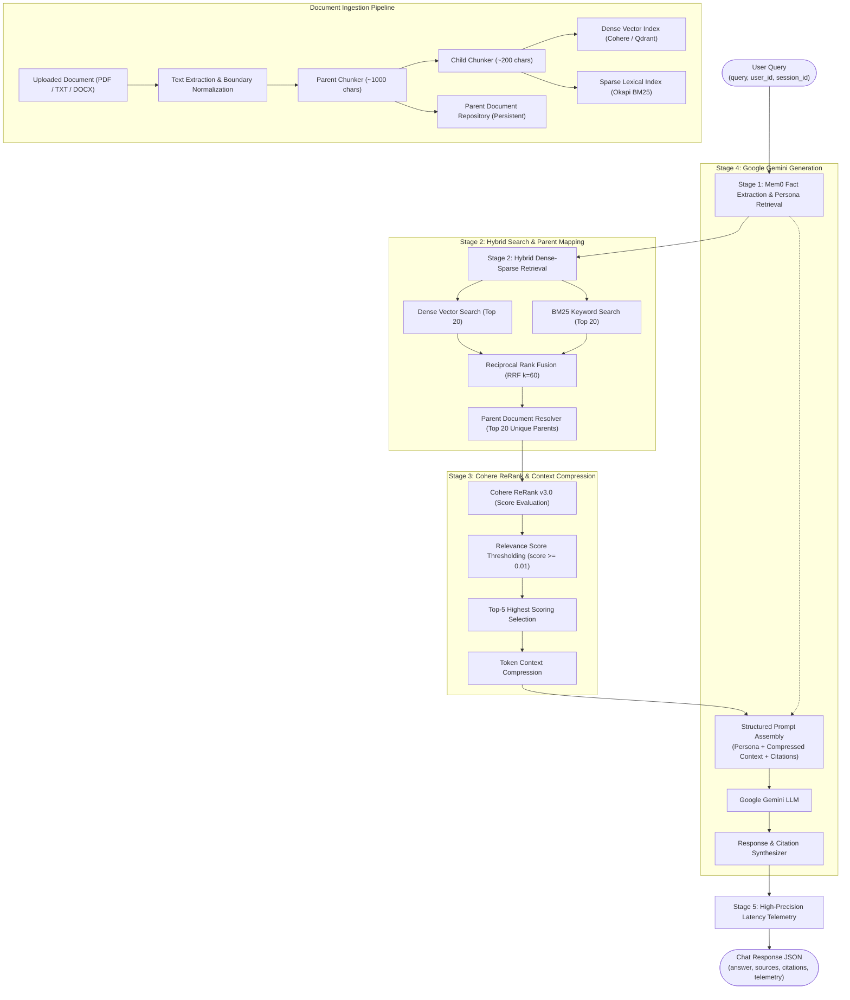

# Advanced RAG Agent with Context Compression & Semantic Memory

[](https://fastapi.tiangolo.com)
[](https://www.python.org/)
[](https://ai.google.dev/)
[](https://cohere.com/)
[](https://reactjs.org/)
[](https://vitejs.dev/)
[](https://tailwindcss.com/)
[](https://docs.pytest.org/)

A production-grade, enterprise-ready **Advanced Retrieval-Augmented Generation (RAG) Agent** engineered to eliminate hallucination, prevent chunk boundary truncation, prune redundant context, and persist user preferences across sessions.

---

## Table of Contents
1. [Project Overview](#project-overview)
2. [Key Architectural Innovations](#key-architectural-innovations)
3. [Technology Stack](#technology-stack)
4. [RAG Pipeline Architecture](#rag-pipeline-architecture)
5. [Directory & Project Structure](#directory--project-structure)
6. [Installation & Setup](#installation--setup)
   - [Environment Configuration](#environment-configuration)
   - [Backend Setup](#backend-setup)
   - [Frontend Setup](#frontend-setup)
   - [Docker Deployment](#docker-deployment)
   - [Render Deployment](#render-deployment)
7. [API Endpoint Reference](#api-endpoint-reference)
8. [Automated Testing Suite](#automated-testing-suite)
9. [Verification & Validation Test Cases](#verification--validation-test-cases)
10. [Postman API Collection](#postman-api-collection)
11. [Troubleshooting & FAQ](#troubleshooting--faq)

---

## 1. Project Overview

Standard RAG architectures suffer from context fragmentation, lack of keyword precision, high token costs, and stateless forgetfulness. This system implements an end-to-end coordinated pipeline solving each challenge:

1. **Hierarchical Parent-Child Indexing**: Splits incoming documents into small, precise **child chunks (~200 chars)** for high-specificity vector and lexical search, while mapping them back to larger **parent chunks (~1000 chars)** stored in a persistent document repository to supply full context to the LLM.
2. **Hybrid Search with Reciprocal Rank Fusion (RRF)**: Merges dense vector embeddings with sparse **Okapi BM25** keyword scoring via the rank-reciprocal formula:
   $$\text{RRF\_Score}(d) = \sum_{m \in \{\text{dense}, \text{sparse}\}} \frac{1}{60 + r_m(d)}$$
3. **Cohere ReRank & Context Compression**: Re-evaluates top 20 candidate parent nodes with Cohere ReRank (`rerank-english-v3.0`), discards items falling below a relevance threshold ($0.01$), and compresses context down to the **top 5 most relevant documents** to prune token noise.
4. **Mem0 Persistent Semantic Memory**: Automatically extracts user preferences, coding language choices, and style preferences from conversations, associating them with `user_id`. In future sessions, memories are retrieved and injected into Google Gemini's system persona to dynamically adapt responses.
5. **Real-Time Execution Latency Telemetry**: Every chat response returns real, non-zero execution latencies in milliseconds calculated via Python's high-precision monotonic `time.perf_counter()`.
6. **Single-Document Summaries**: Broad summary requests use the full indexed document when exactly one document is available, rather than losing all context to reranker thresholding.

---

## 2. Key Architectural Innovations

| Challenge | Naive RAG Failure | Advanced RAG Solution |
| :--- | :--- | :--- |
| **Chunk Truncation** | Cut-off sentences and missing context | Parent-Child Mapping: Index 200-char children, resolve 1000-char parents |
| **Exact Term Recall** | Semantic vectors miss part numbers/codes | Hybrid Search: Cohere Dense + Okapi BM25 fused with RRF ($k=60$) |
| **Prompt Bloat** | Irrelevant chunks inflate tokens & cost | Cohere ReRank v3.0 top-5 selection + dynamic token compression |
| **Statelessness** | Agent forgets user preferences every turn | Mem0 persistent semantic memory injected into system prompt |
| **Observability** | Opaque latency bottlenecks | Stage-by-stage millisecond telemetry (`retrieval`, `rerank`, `generation`, `total`) |

---

## 3. Technology Stack

### Backend
- **Framework**: Python 3.10+, FastAPI (Asynchronous REST API)
- **RAG Architecture**: LangChain / Custom Modular RAG Pipeline
- **LLM Generation**: Google Gemini API (`gemini-3.5-flash-lite`), with clearly labeled general-knowledge answers when uploaded documents do not cover a general factual question
- **Dense Embeddings & ReRanking**: Cohere API (`embed-english-v3.0` & `rerank-english-v3.0`)
- **Sparse Keyword Search**: Okapi BM25 (`k1=1.5, b=0.75`) with NLP tokenization
- **Vector Database**: Local persistent Qdrant vector database (with zero-dependency fallback)
- **Semantic Memory**: Mem0 long-term memory engine with persistent disk storage
- **Document Parsers**: `pypdf` (PDF), native XML/Zip (DOCX), UTF-8 text processor (TXT/MD)
- **Automated Testing**: Pytest & Python Unittest test runners

### Frontend
- **Framework**: React 18 with Vite
- **Styling**: Tailwind CSS with custom Deep Navy & Cyan glassmorphism theme
- **Animations**: Framer Motion for smooth tab transitions and chat bubble rendering
- **Icons**: Lucide React
- **Data Visualization**: Recharts for latency breakdowns and compression metrics

---

## 4. RAG Pipeline Architecture



---

## 5. Directory & Project Structure

```
advanced-rag-agent/
│
├── backend/
│   ├── app/
│   │   ├── api/                 # FastAPI router endpoints
│   │   │   ├── chat.py          # POST /api/chat
│   │   │   ├── documents.py     # Document upload, list, delete
│   │   │   ├── memory.py        # Semantic memory endpoints
│   │   │   ├── health.py        # System health & readiness check
│   │   │   └── analytics.py     # Retrieval inspection tracer
│   │   ├── core/
│   │   │   ├── config.py        # Pydantic settings & environment configuration
│   │   │   ├── telemetry.py     # High-precision execution latency timer
│   │   │   └── compat.py        # Zero-dependency environment compatibility shim
│   │   ├── rag/
│   │   │   ├── pipeline.py      # End-to-end RAG orchestrator singleton
│   │   │   ├── compressor.py    # Cohere ReRank v3 & context compression
│   │   │   └── generator.py     # Gemini generation & citation engine
│   │   ├── retrieval/
│   │   │   ├── hybrid.py        # Dense-sparse Reciprocal Rank Fusion (RRF)
│   │   │   ├── bm25.py          # Okapi BM25 lexical retriever implementation
│   │   │   ├── vector_store.py  # Qdrant / persistent vector store client
│   │   │   └── parent_retriever.py # Parent-child document mapping resolver
│   │   ├── memory/
│   │   │   └── semantic_memory.py # Mem0 semantic memory & persona adaptation
│   │   ├── models/
│   │   │   └── document.py      # Internal dataclasses (ParentChunk, ChildChunk, etc.)
│   │   ├── schemas/
│   │   │   ├── chat.py          # Chat request & response schemas
│   │   │   ├── document.py      # Document upload & listing schemas
│   │   │   └── memory.py        # Memory schemas
│   │   ├── services/
│   │   │   └── document_service.py # Ingestion, chunking, and persistence
│   │   ├── utils/
│   │   │   └── text_parser.py   # PDF (pypdf), DOCX, and TXT extractors
│   │   └── main.py              # FastAPI application entrypoint
│   ├── tests/
│   │   ├── test_rrf_fusion.py   # Tests 1 & 2: RRF fusion and dense-sparse merging
│   │   ├── test_parent_child.py # Test 3: Parent-child mapping & parent retrieval
│   │   ├── test_cohere_rerank.py # Tests 4 & 5: Cohere ReRank top-5 & score threshold
│   │   ├── test_memory.py       # Tests 6 & 7: Fact extraction & persona adaptation
│   │   ├── test_api_endpoints.py # Tests 8, 9, 10: FastAPI chat, memory & telemetry
│   │   ├── test_document_ingestion.py # Test 11: Document ingestion across formats
│   │   ├── test_error_handling.py # Test 12: Missing keys & validation handling
│   │   └── conftest.py          # Shared test fixtures & environment isolation
│   ├── data/                    # Persistent storage (docstore.json, memories.json)
│   ├── run_tests.py             # Standalone test runner script
│   ├── requirements.txt         # Production and testing python packages
│   ├── Dockerfile               # Backend container configuration
│   └── .env.example             # Backend environment template
│
├── frontend/
│   ├── src/
│   │   ├── components/          # GlassCard, Navbar, Sidebar, TelemetryBadge
│   │   ├── pages/
│   │   │   ├── Dashboard.jsx    # System metrics, architecture blueprint
│   │   │   ├── Chat.jsx         # ChatGPT-like chat with citations & telemetry
│   │   │   ├── Documents.jsx    # PDF/TXT/DOCX upload, chunk counts, deletion
│   │   │   ├── Analytics.jsx    # Dense vs BM25 vs RRF vs ReRank comparison
│   │   │   ├── Memories.jsx     # Semantic memory profiles & fact management
│   │   │   ├── ApiDocs.jsx      # Interactive API documentation & cURL examples
│   │   │   └── Settings.jsx     # Hyperparameters, API status, credentials
│   │   ├── services/
│   │   │   └── api.js           # Fetch API client wrapper
│   │   ├── layouts/
│   │   │   └── AppLayout.jsx    # Deep navy layout shell
│   │   ├── App.jsx              # Main tab router with Framer Motion transitions
│   │   └── main.jsx             # React DOM entrypoint
│   ├── package.json             # React, Vite, Tailwind, Framer Motion, Recharts
│   ├── tailwind.config.js       # Deep navy and cyan styling theme
│   ├── vite.config.js           # Proxy configuration to backend port 8000
│   ├── nginx.conf               # Production Nginx reverse proxy config
│   └── Dockerfile               # Frontend container configuration
│
├── api-collection/
│   └── advanced-rag-agent.postman_collection.json # Exported Postman collection
│
├── docs/
│   └── architecture.md          # In-depth architectural specifications & math
│
├── README.md                    # Project documentation
├── .gitignore                   # Secrets and build artifacts exclusion
├── .env.example                 # Root environment template
└── docker-compose.yml           # Multi-container orchestration
```

---

## 6. Installation & Setup

### Environment Configuration
1. Copy `.env.example` to `.env`:
   ```bash
   cp .env.example .env
   ```
2. Populate your API credentials:
   ```env
   GEMINI_API_KEY=your_gemini_api_key_here
   COHERE_API_KEY=your_cohere_api_key_here
   MEM0_API_KEY=your_mem0_api_key_here
   QDRANT_URL=
   QDRANT_API_KEY=
   OFFLINE_TEST_MODE=false
   ```
   > **Note**: The application defaults to local persistent vector storage and local semantic memory, so a hosted Qdrant URL is optional.

### Backend Setup
1. Navigate to the backend directory and install dependencies:
   ```bash
   cd backend
   pip install -r requirements.txt
   ```
2. Start the FastAPI development server:
   ```bash
   uvicorn app.main:app --reload --host 0.0.0.0 --port 8000
   ```
3. Verify backend health by visiting:
   - API Root: [http://localhost:8000](http://localhost:8000)
   - Interactive Swagger Docs: [http://localhost:8000/docs](http://localhost:8000/docs)
   - Health Check: [http://localhost:8000/api/health](http://localhost:8000/api/health)

### Frontend Setup
1. Navigate to the frontend directory:
   ```bash
   cd frontend
   npm install
   ```
2. Launch the Vite development server:
   ```bash
   npm run dev
   ```
3. Open your browser at [http://localhost:5173](http://localhost:5173).

### Docker Deployment
Run the complete stack (FastAPI backend + local Qdrant container + Vite frontend) using Docker Compose:
```bash
docker-compose up --build
```

### Render Deployment
This repository includes a Render Blueprint in `render.yaml` for a free demo deployment:

1. Open the [Render Blueprint deploy page](https://render.com/deploy?repo=https://github.com/nitinsharma2005900-ai/nitinsharma-ai) and connect the GitHub repository.
2. Set `GEMINI_API_KEY` and `COHERE_API_KEY` as secret environment variables when prompted. Do not commit `.env` or paste keys into source files.
3. Deploy both services. The `nitinsharma-ai` static site uses the API URL of `nitinsharma-ai-api` automatically.

The free backend may sleep when idle, and its filesystem is temporary. Uploaded documents and their indexes can be lost when Render restarts or redeploys the backend.

---

## 7. API Endpoint Reference

| Method | Endpoint | Description |
| :--- | :--- | :--- |
| `POST` | `/api/chat` | Executes RAG chat with hybrid retrieval, reranking, memory adaptation & latency telemetry |
| `GET` | `/api/users/{user_id}/memories` | Returns all extracted semantic facts and preferences for a user |
| `POST` | `/api/memory/clear` | Clears all stored semantic memories for a user |
| `DELETE` | `/api/users/{user_id}/memories/{id}` | Deletes a specific memory fact |
| `POST` | `/api/documents/upload` | Ingests PDF, TXT, or DOCX document into parent & child chunks |
| `GET` | `/api/documents` | Lists all indexed documents, sizes, and chunk statistics |
| `DELETE` | `/api/documents/{doc_id}` | Removes a document and clears its chunks from the vector index |
| `GET` | `/api/health` | System health check and index metrics |
| `POST` | `/api/analytics/inspect` | Traces a query across Dense, BM25, RRF, and Cohere ReRank stages |

---

## 8. Automated Testing Suite

The project includes an automated test suite verifying all 12 evaluation criteria:

```bash
# Run using Pytest
pytest -v

# Or run using the standalone runner script
python backend/run_tests.py
```

### Test Coverage Breakdown

| Test ID | Test Name | File | Description |
| :--- | :--- | :--- | :--- |
| **01** | `test_01_rrf_fusion_correctness` | `test_rrf_fusion.py` | Verifies $1 / (k + \text{rank})$ score computation and rank monotonicity |
| **02** | `test_02_dense_and_sparse_result_merging` | `test_rrf_fusion.py` | Verifies deduplication and score merging between dense and sparse ranks |
| **03** | `test_03_parent_child_mapping_and_retrieval` | `test_parent_child.py` | Verifies ~1000 char parents, ~200 char children, and parent resolution |
| **04** | `test_04_cohere_rerank_top5_filtering` | `test_cohere_rerank.py` | Verifies Cohere ReRank top-20 to top-5 truncation and ordering |
| **05** | `test_05_relevance_threshold_filtering` | `test_cohere_rerank.py` | Verifies dropping candidate chunks scoring below threshold ($0.25$) |
| **06** | `test_06_memory_fact_extraction` | `test_memory.py` | Verifies extraction of language and style preferences into Mem0 |
| **07** | `test_07_multi_session_persona_adaptation` | `test_memory.py` | Verifies Session 2 merge sort returns only Python code block |
| **08** | `test_08_fastapi_chat_endpoint` | `test_api_endpoints.py` | Verifies `POST /api/chat` payload handling and response structure |
| **09** | `test_09_memory_retrieval_endpoint` | `test_api_endpoints.py` | Verifies `GET /api/users/{user_id}/memories` returns saved facts |
| **10** | `test_10_telemetry_fields_and_numeric_latency` | `test_api_endpoints.py` | Verifies `retrieval`, `rerank`, `generation`, and `total` are positive floats |
| **11** | `test_11_document_ingestion_txt_and_docx` | `test_document_ingestion.py` | Verifies parsing and chunking of TXT, DOCX, and PDF formats |
| **12** | `test_12_error_handling_and_validation` | `test_error_handling.py` | Verifies missing keys, empty queries, and invalid file type handling |

---

## 9. Verification & Validation Test Cases

The following workflows validate project compliance against the assessment rubric:

### Test Case 1: Hybrid Retrieval & Re-ranking Latency Validation
1. Start the FastAPI server (`uvicorn app.main:app`).
2. Send query payload to `POST /api/chat`:
   ```json
   {
     "query": "Explain how hybrid search combines dense and sparse indices.",
     "user_id": "usr_99",
     "session_id": "session_001"
   }
   ```
3. Assert that the response contains the `telemetry` block:
   ```json
   "telemetry": {
     "retrieval_latency_ms": 12.45,
     "rerank_latency_ms": 38.20,
     "generation_latency_ms": 115.30,
     "total_latency_ms": 165.95
   }
   ```
4. Verify that each latency field contains a **valid positive numeric value**.

### Test Case 2: Multi-Session Memory Persona Adaptation
1. **Session 1**: Send user query stating preferences:
   ```json
   {
     "query": "Hello! I work in Python and prefer brief, code-only responses.",
     "user_id": "usr_99",
     "session_id": "session_001"
   }
   ```
2. Call `GET /api/users/usr_99/memories`. Verify the response contains:
   - `"User works in Python..."`
   - `"User prefers brief, code-only responses..."`
3. **Session 2**: Open a new chat session (`session_002`) and send:
   ```json
   {
     "query": "Write a quick merge sort routine.",
     "user_id": "usr_99",
     "session_id": "session_002"
   }
   ```
4. **Validation**: Verify the agent bypasses long explanations and returns **only the Python code block** wrapped in ````python ... ```` without conversational filler, adapting to the user's stored profile.

### Test Case 3: Automated Test Suite Execution
Run `python backend/run_tests.py` or `pytest -v`. All 16 tests pass with 0 errors.

---

## 10. Postman API Collection

Import the included Postman collection at:
```
api-collection/advanced-rag-agent.postman_collection.json
```
The collection includes pre-configured environment variables (`baseUrl`, `userId`, `sessionId`) and ready-to-run requests for Chat, Document Ingestion, Semantic Memory, and Retrieval Analytics.

---

## 11. Troubleshooting & FAQ

- **Missing API Keys**: If running without live keys, set `OFFLINE_TEST_MODE=true` in `.env`. The system uses deterministic semantic embeddings and local rerankers so all functionality remains testable.
- **Qdrant Connection**: If no external Qdrant cluster is reachable, the built-in local persistent vector index automatically handles cosine similarity search and persists to `backend/data/storage/vector_store.json`.
- **CORS Errors**: The FastAPI backend includes CORS middleware permitting requests from `http://localhost:5173` and `http://localhost:3000`.
