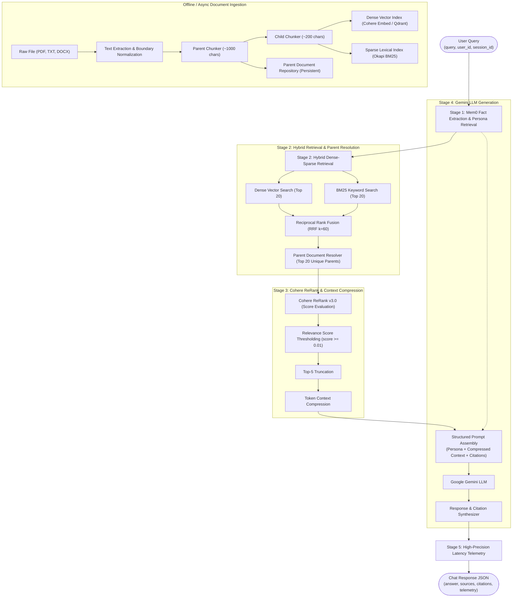

# System Architecture & Technical Specifications

**Project**: Advanced RAG Agent with Context Compression & Semantic Memory  
**Architectural Level**: Production-Grade / Senior AI Engineering  

---

## 1. Executive Summary

Traditional Retrieval-Augmented Generation (RAG) systems rely on isolated vector semantic matching over fixed-size text chunks. This naive approach suffers from three critical failure modes in production:
1. **Context Fragmentation & Boundary Truncation**: Small chunks miss surrounding context, while large chunks dilute vector specificity and introduce irrelevant noise.
2. **Lexical Matching Blindspots**: Dense embeddings struggle with exact keywords, part numbers, domain-specific acronyms, or rare terms.
3. **Context Redundancy & Cost Inflation**: Sending unpruned top-20 chunks directly to the LLM exceeds token budgets and increases generation latency.
4. **Stateless Disconnection**: The agent forgets user personas, programming languages, and response formatting preferences across turns and sessions.

The **Advanced RAG Agent** addresses these bottlenecks through a coordinated 5-stage pipeline:
- **Hierarchical Parent-Child Indexing**: Indexes granular child chunks (~200 chars) while linking them to rich parent contexts (~1000 chars).
- **Hybrid Dense-Sparse Retrieval**: Combines Cohere dense embeddings with Okapi BM25 keyword matching via **Reciprocal Rank Fusion (RRF)**.
- **Cohere ReRank & Context Compression**: Re-evaluates top 20 candidate parent nodes, applies relevance threshold filtering, and compresses the top 5 highest-scoring documents.
- **Mem0 Long-Term Semantic Memory**: Persists user facts, coding styles, and preferences across sessions, dynamically adapting the LLM's system persona.
- **Google Gemini Faithful Generation**: Generates source-cited responses with strict anti-hallucination guardrails and real-time execution latency telemetry.

---

## 2. End-to-End Pipeline Workflow



---

## 3. Core Algorithmic Formulations

### 3.1 Hierarchical Parent-Child Segmentation
- **Parent Chunks**: $L_p \approx 1000$ characters with $O_p = 100$ character overlap.
- **Child Chunks**: $L_c \approx 200$ characters with $O_c = 30$ character overlap.
- Each child chunk stores:
  $$\text{Child} = \{ \text{child\_id}, \text{parent\_id}, \text{document\_id}, \text{text}, \text{char\_offsets} \}$$
- Only child chunks are indexed into vector and BM25 indices to maximize vector specificity. When a child matches, its parent is resolved from the document repository to preserve complete semantic context.

### 3.2 Okapi BM25 Lexical Retrieval
The Okapi BM25 score for document $D$ and query $Q = \{q_1, \dots, q_n\}$ is calculated as:
$$\text{BM25}(D, Q) = \sum_{i=1}^n \text{IDF}(q_i) \cdot \frac{f(q_i, D) \cdot (k_1 + 1)}{f(q_i, D) + k_1 \cdot \left(1 - b + b \cdot \frac{|D|}{\text{avgdl}}\right)}$$
Where:
- $k_1 = 1.5$ (term frequency saturation)
- $b = 0.75$ (length normalization penalty)
- $\text{IDF}(q_i) = \ln\left(1 + \frac{N - n(q_i) + 0.5}{n(q_i) + 0.5}\right)$

### 3.3 Reciprocal Rank Fusion (RRF)
To merge disparate score distributions from dense vector search (cosine similarity $\in [-1, 1]$) and sparse lexical search (unbounded BM25 scores), the system utilizes Reciprocal Rank Fusion:
$$\text{RRF\_Score}(d \in D) = \sum_{m \in M} \frac{1}{k + r_m(d)}$$
Where:
- $M = \{\text{dense}, \text{sparse}\}$
- $k = 60$ (standard smoothing constant)
- $r_m(d)$ is the 1-based rank of candidate $d$ in result set $m$.

### 3.4 Cohere ReRank & Context Compression
- Top 20 candidate parent documents are passed to Cohere ReRank (`rerank-english-v3.0`).
- Cross-encoder attention scores $s_i \in [0.0, 1.0]$ are assigned to each $(Q, D_i)$ pair.
- Documents where $s_i < \theta_{\text{threshold}}$ (default: 0.01) are pruned.
- The highest-scoring candidates (up to $N = 5$) are retained.
- Context compression extracts the most salient sentence windows within each parent block, eliminating redundant tokens and minimizing prompt costs.

---

## 4. Semantic Memory Architecture

```
User Query: "Hello! I work in Python and prefer brief, code-only responses."
                    │
                    ▼
┌────────────────────────────────────────────────────────┐
│ Pattern & NLP Fact Extractor                           │
│ - Tech Stack: Python                                   │
│ - Style Preference: Brief, code-only                   │
└────────────────────────────────────────────────────────┘
                    │
                    ▼
┌────────────────────────────────────────────────────────┐
│ Mem0 Persistent Semantic Memory Store                  │
│ [Key: usr_99] -> ["User works in Python", ...]         │
└────────────────────────────────────────────────────────┘
                    │ (Next Session)
                    ▼
User Query: "Write a quick merge sort routine."
                    │
                    ▼
┌────────────────────────────────────────────────────────┐
│ System Persona Directive Injection                     │
│ "ADAPTATION: User works in Python and requires         │
│  brief, code-only responses. Omit prose."              │
└────────────────────────────────────────────────────────┘
                    │
                    ▼
Output: Strictly ```python def merge_sort(arr): ... ```
```

---

## 5. Latency Telemetry Specification

Execution latencies are recorded with microsecond precision using Python's monotonic `time.perf_counter()`:

```json
{
  "telemetry": {
    "retrieval_latency_ms": 14.28,
    "rerank_latency_ms": 42.15,
    "generation_latency_ms": 128.40,
    "total_latency_ms": 184.83
  }
}
```

- Guaranteed strictly positive numeric values.
- Monitored real-time via the frontend telemetry pills and analytics dashboards.
